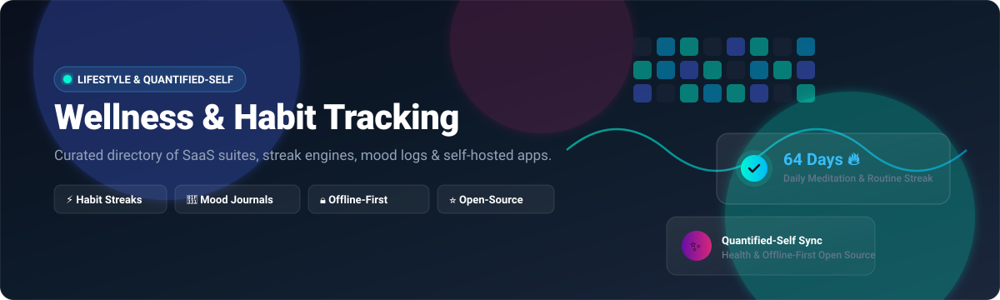

# Awesome Wellness, Habit Tracking & Lifestyle Apps 🌟

  

  
  
  
  
  
  

> 🎯 A curated directory of the best **Habit Trackers**, **Daily Routine Planners**, **Mood Journals**, **Mental Wellness Apps**, and **Quantified-Self Systems** — spanning leading SaaS platforms and self-hosted, privacy-first open-source GitHub projects.

Whether you're looking for offline-first habit trackers 📱, gamified routine builders 🎮, streak counters ⚡, mindfulness journals 🧘, or local-first quantified-self analytics 📊, this list gathers top tools to optimize daily health, productivity, and lifestyle wellness.

---

## 📌 Table of Contents

- [📊 Sector Overview & Market Dynamics](#-sector-overview--market-dynamics)
- [💼 Top SaaS & Mobile Apps](#-top-saas--mobile-apps)
- [⭐ Open-Source GitHub Projects](#-open-source-github-projects)
  - [🏆 Top Ranked by GitHub_Stars](#-top-ranked-by-github-stars)
  - [📱 Mobile & Offline-First Habit Trackers](#-mobile--offline-first-habit-trackers)
  - [🌐 Self-Hosted & Web Streak Trackers](#-self-hosted--web-streak-trackers)
  - [🧠 Mood Journaling & Mental Wellness](#-mood-journaling--mental-wellness)
  - [⌨️ Terminal, CLI & Obsidian Habit Tracking](#️-terminal-cli--obsidian-habit-tracking)
  - [🥗 Quantified-Self, Physical Health & Personal CRM](#-quantified-self-physical-health--personal-crm)
- [⚖️ Comparison Matrix](#️-comparison-matrix)
- [🧭 How to Choose the Right Tool](#-how-to-choose-the-right-tool)
- [🤝 How to Contribute](#-how-to-contribute)
- [💖 Support](#-support)
- [📈 Star History](#-star-history)
- [📄 License & Disclaimer](#-license--disclaimer)

---

## 📊 Sector Overview & Market Dynamics

The global mental wellness, habit tracking, and digital self-improvement software market is valued at approximately **$5.2 billion to $6.8 billion**, expanding at a robust compound annual growth rate (CAGR) of over **16.5%**. The sector is **moderately fragmented**: while a handful of well-capitalized lifestyle and mindfulness giants (such as Headspace Health and Fabulous) capture enterprise employee-assistance contracts and broad consumer awareness, high user churn and nuanced personal workflows have prevented a "winner-take-all" outcome, allowing independent indie developers, gamified habit apps (e.g., Finch, Habitica), and privacy-first offline open-source platforms to flourish alongside dominant market leaders.

---

## 💼 Top SaaS & Mobile Apps

The following table lists leading commercial and freemium SaaS platforms in the wellness and habit tracking ecosystem, ranked by company size (valuation/estimated annual recurring revenue in descending order):

| Product / Platform 🚀 | Pricing (Starting Tier) 💳 | Free Tier / Free Trial Limits 🎁 | Company Scale (Valuation / Est. ARR) 🏢 | Primary Focus & Highlights 🌟 |
|:---|:---|:---|:---|:---|
| **[Headspace](https://headspace.com)** | $12.99/mo (or $69.99/yr) | 14-day free trial on annual plan (7-day free trial on monthly plan); provides access to full library of 500+ guided meditations & sleepcasts | **Valuation: ~$3.0 Billion** (Headspace Health merger, ~$250M+ ARR) | Guided mindfulness, daily meditation courses, SOS breathing exercises, and sleep soundtracks. |
| **[Fabulous](https://thefabulous.co)** | $39.99/yr (or $3.33/mo billed annually) | 7-day free trial with full behavioral coaching access; recurring free plan limited to basic morning habit checklist without daily coaching journeys | **Valuation: ~$120M+** (~$25M+ ARR, incubated at Duke University) | Behavioral economics science, morning rituals, hydration triggers, and structured multi-week habit resets. |
| **[Daylio](https://daylio.net)** | $4.99/mo (or $29.99/yr, $59.99 lifetime) | 100% Free Forever tier available with unlimited daily entries, standard mood icons, and basic weekly charts; Premium unlocks advanced correlation analytics & unlimited PIN locks | **Acquired by Habitics / ~$15M+ ARR** (Over 15M+ lifetime downloads) | Two-tap micro-diary and mood logging without mandatory typing; discover behavioral mood correlations. |
| **[Productive](https://productiveapp.io)** | $6.99/mo (or $29.99/yr, $39.99 lifetime) | Free Forever plan limited to a maximum of 5 active habits; 7-day free trial for Premium (unlimited habits, smart location reminders, in-depth stats) | **Apalon / Mosaic Group (~$12M+ ARR)** | Time-of-day habit scheduling (Morning, Afternoon, Evening) with streak challenges and motivational notifications. |
| **[Finch](https://finchcare.com)** | $5.99/mo (or $39.99/yr Finch Plus) | Generous Free Forever tier with full virtual pet care, daily goals, gratitude check-ins, and soundscapes; Finch Plus unlocks extra pet outfits, seasonal events & in-depth quizzes | **Valuation: ~$40M+** (~$10M+ ARR, backed by Y Combinator) | Gamified self-care companion app where completing real-world habits and breathing exercises nurtures a virtual pet. |
| **[Habitify](https://habitify.me)** | $4.99/mo (or $29.99/yr, $64.99 lifetime) | Free Forever plan limited to 3 active habits and 1 reminder per habit; 7-day free trial on annual subscription unlocks unlimited habits and Apple Health sync | **Independent Studio (~$3.5M ARR)** (Over 2M+ registered users) | Minimalist cross-platform habit dashboard with Apple Health & Google Fit sync, time-grouping, and privacy logs. |
| **[Strides](https://stridesapp.com)** | $4.99/mo (or $29.99/yr, $79.99 lifetime) | Free Forever plan limited to 7 active habit trackers and basic calendar view; Strides Plus unlocks unlimited trackers, data export & sync across devices | **Bootstrapped Indie (~$2.0M ARR)** | Comprehensive four-tracker engine: Target Goals, Recurring Habits, Average Values, and Milestone Projects. |
| **[Everyday](https://everyday.app)** | $4.99/mo (or $29.99/yr, $79.99 lifetime) | Free Forever tier limited to 3 active habits across Web and Mobile; 7-day free trial of Everyday Pro provides unlimited habits, color palettes & extensions | **Bootstrapped Indie (~$1.2M ARR)** | Visual streak chain builder with clean color-coded heatmaps across Web, iOS, Android, macOS, and extensions. |
| **[Streaks](https://streaksapp.com)** | $5.99 one-time purchase (Pay-once, No recurring subscription) | No ongoing free tier; standard Apple App Store refund policy applies (7-day trial period through Family Sharing / direct purchase) | **Indie Excellence (~$1.0M+ ARR)** (Apple Design Award Winner) | Direct bidirectional Apple Health integration automatically completing fitness, walking, mindfulness, and sleep habits. |
| **[Done](https://thedoneapp.com)** | $2.99/mo (or $14.99/yr, $39.99 lifetime) | Free Forever tier limited to tracking up to 3 habits; Done Premium unlocks unlimited habits, multiple daily check-ins, CSV exports & passcode lock | **Independent Studio (~$800K ARR)** | High-contrast visual habit tracker designed to reinforce positive routines and quit negative addictions. |
| **[Way of Life](https://wayoflifeapp.com)** | $4.99/mo (or $24.99/yr, $49.99 lifetime) | Free Forever tier limited to tracking up to 3 habits with basic bar chart history; Premium unlocks unlimited habits, cloud backup, and interactive diary notes | **Bootstrapped Indie (~$500K ARR)** | Color-coded red/green daily status system to pinpoint long-term behavioral trends and lifestyle triggers. |

---

## ⭐ Open-Source GitHub Projects

### 🏆 Top Ranked by GitHub_Stars

The open-source wellness ecosystem features self-hosted platforms, privacy-first mobile habit trackers, and local-first quantified-self tools. All repositories below are **ranked in descending order of GitHub stargazers**:

1. 🌟 **[Trilium Notes (`zadam/trilium` / `TriliumNext/Trilium`)](https://github.com/TriliumNext/Trilium)**  — **~38,996 Stars**  
   *Hierarchical personal knowledge base and lifestyle journaling system with built-in daily note templates, habit streak attributes, and self-hosted end-to-end sync.*

2. 🌟 **[Monica Personal CRM (`monicahq/monica`)](https://github.com/monicahq/monica)**  — **~25,806 Stars**  
   *Open-source self-hosted personal relationship management and social wellness tracker. Log conversations, record birthdays, track social health, and manage personal life milestones.*

3. 🌟 **[Super Productivity (`super-productivity/super-productivity`)](https://github.com/super-productivity/super-productivity)**  — **~23,807 Stars**  
   *Advanced offline-first todo list, timeboxer, and habit tracker. Comes with mandatory wellness rest breaks, Pomodoro intervals, Jira/GitHub integrations, and local-first storage.*

4. 🌟 **[ActivityWatch (`ActivityWatch/activitywatch`)](https://github.com/ActivityWatch/activitywatch)**  — **~19,728 Stars**  
   *Leading privacy-first, automated quantified-self lifestyle and screen-time tracker. Runs locally in the background, logging app usage, digital habits, and productivity patterns.*

5. 🌟 **[Habitica (`HabitRPG/habitica`)](https://github.com/HabitRPG/habitica)**  — **~14,322 Stars**  
   *The definitive open-source gamified habit-building RPG. Transform real-world habits, daily goals, and wellness routines into role-playing quests, equipment drops, and party accountability.*

6. 🌟 **[Loop Habit Tracker (`iSoron/uhabits`)](https://github.com/iSoron/uhabits)**  — **~10,426 Stars**  
   *The gold-standard Android habit tracker. Completely ad-free and open-source with mathematical habit score formulas, flexible weekly schedules, offline widgets, and database export.*

7. 🌟 **[wger Workout Manager (`wger-project/wger`)](https://github.com/wger-project/wger)**  — **~7,290 Stars**  
   *Self-hosted open-source workout, fitness routine, and personal nutrition tracker. Manage exercises, weight logs, body metrics, and meal schedules in your private homelab.*

8. 🌟 **[Pomotroid (`Splode/pomotroid`)](https://github.com/Splode/pomotroid)**  — **~5,622 Stars**  
   *Simple, aesthetically pleasing, and customizable Pomodoro timer desktop application encouraging mindful work sessions and structured wellness rest intervals.*

9. 🌟 **[dijo (`oppiliappan/dijo`)](https://github.com/oppiliappan/dijo)**  — **~2,924 Stars**  
   *Scriptable, lightweight, ncurses-based digital habit tracker for the terminal. Built for CLI enthusiasts who want seamless keyboard-driven daily habit checks.*

10. 🌟 **[Obsidian Tracker (`pyrochlore/obsidian-tracker`)](https://github.com/pyrochlore/obsidian-tracker)**  — **~1,966 Stars**  
    *Powerful Obsidian plugin for tracking occurrences, numbers, moods, and habits across daily markdown notes with dynamic streak charts and summary graphs.*

11. 🌟 **[Beaver Habit Tracker (`daya0576/beaverhabits`)](https://github.com/daya0576/beaverhabits)**  — **~1,866 Stars**  
    *Self-hosted open-source habit tracking web application built without punishing "failed goals," focusing on simple daily check-ins and visual GitHub-style streak grids.*

12. 🌟 **[Table Habit (`FriesI23/mhabit`)](https://github.com/FriesI23/mhabit)**  — **~1,704 Stars**  
    *Modern cross-platform Flutter habit tracker for Android, iOS, Windows, macOS, and Linux featuring smart habit curve formulas, local-first storage, and WebDAV sync.*

13. 🌟 **[Habo (`xpavle00/Habo`)](https://github.com/xpavle00/Habo)**  — **~1,576 Stars**  
    *Privacy-first open-source mobile habit tracker for iOS and Android featuring end-to-end encrypted sync, clean UI, and self-hosted server backend option.*

14. 🌟 **[Daily_You (`Demizo/Daily_You`)](https://github.com/Demizo/Daily_You)**  — **~1,427 Stars**  
    *Private, encrypted offline-first diary and mood journal app. Protect your emotional reflections with biometrics and discover personal mental health trends.*

15. 🌟 **[Journiv (`journiv/journiv-app`)](https://github.com/journiv/journiv-app)**  — **~1,261 Stars**  
    *Self-hosted, privacy-respecting journaling and mood logging web application for personal wellness reflections, mental health checks, and memories.*

16. 🌟 **[Grit (`shub39/Grit`)](https://github.com/shub39/Grit)**  — **~1,236 Stars**  
    *Minimal, beautiful to-do list and habit tracker built for Android with smooth animations, custom category tags, and zero data tracking.*

17. 🌟 **[Streak (`InlitX/streak`)](https://github.com/InlitX/streak)**  — **~1,220 Stars**  
    *Offline-first habit tracker written in Flutter supporting positive streaks, negative habit avoidance, quantitative metrics, and direct data migration from Loop.*

18. 🌟 **[Waistline (`davidhealey/waistline`)](https://github.com/davidhealey/waistline)**  — **~760 Stars**  
    *Open-source calorie counter and food nutrition diary for Android featuring Open Food Facts barcode scanning and zero telemetry.*

19. 🌟 **[HealthLog (`MBombeck/HealthLog`)](https://github.com/MBombeck/HealthLog)**  — **~318 Stars**  
    *Self-hosted health tracking PWA for weight, blood pressure, glucose, sleep, mood, and medications, with sync from Apple Health, Garmin, WHOOP, and Oura.*

20. 🌟 **[HabitBuilder (`ofalvai/HabitBuilder`)](https://github.com/ofalvai/HabitBuilder)**  — **~292 Stars**  
    *Clean native Android habit tracker built with Kotlin and Jetpack Compose featuring detailed completion heatmaps and zero analytics tracking.*

21. 🌟 **[ToDont (`Crazy-Marvin/ToDont`)](https://github.com/Crazy-Marvin/ToDont)**  — **~189 Stars**  
    *An open-source "reverse to-do list" helping you break bad habits, quit addictions, and track impulse triggers on Android.*

22. 🌟 **[Pixy Mood Tracker (`mrzmyr/pixy-mood-tracker-app`)](https://github.com/mrzmyr/pixy-mood-tracker-app)**  — **~158 Stars**  
    *Offline-first "Year in Pixels" mood tracker and micro-journal for Android and iOS with zero ads, zero accounts, and zero third-party telemetry.*

23. 🌟 **[Obsidian Habit Tracker Plugin (`zincplusplus/habit-tracker`)](https://github.com/zincplusplus/habit-tracker)**  — **~148 Stars**  
    *Markdown-native habit tracker plugin for Obsidian knowledge vaults to visualize daily consistency and build streaks directly inside personal notes.*

24. 🌟 **[Grove (`resurrectdev1/Grove`)](https://github.com/resurrectdev1/Grove)**  — **~130 Stars**  
    *Minimalist Flutter habit and sobriety tracking app for Android designed to visualize long-term lifestyle progress without distractions.*

25. 🌟 **[Flux (`wisamidris77/flux`)](https://github.com/wisamidris77/flux)**  — **~124 Stars**  
    *Cross-platform open-source Flutter habit tracker for fitness routines, daily reading targets, and quitting negative habits.*

26. 🌟 **[Sprout (`kb019/sprout`)](https://github.com/kb019/sprout)**  — **~65 Stars**  
    *Ultra-lightweight Rust Terminal User Interface (TUI) habit tracker for developers managing daily workflows and routines in the CLI.*

27. 🌟 **[Moodtracker (`benji6/moodtracker`)](https://github.com/benji6/moodtracker)**  — **~57 Stars**  
    *Serverless, offline-capable Progressive Web App (PWA) for mindful mood tracking, mental wellness reflection, and emotional logs.*

28. 🌟 **[Habitus (`AndromedaTechnology/habitus`)](https://github.com/AndromedaTechnology/habitus)**  — **~47 Stars**  
    *Anonymous, open-source gamified mental wellness tracker built with TypeScript and Vue for emotional well-being self-monitoring.*

29. 🌟 **[Break Bad Habits (`epicarchitect/breakbadhabits`)](https://github.com/epicarchitect/breakbadhabits)**  — **~38 Stars**  
    *Kotlin Multiplatform app built with Compose for tracking sobriety milestones, relapse-free intervals, and overcoming bad habits.*

30. 🌟 **[Easpace (`bmartin042503/easpace`)](https://github.com/bmartin042503/easpace)**  — **~2 Stars**  
    *Private offline desktop mental health companion built with .NET and Avalonia UI, offering mood logs, guided breathing, and journaling.*

---

### 📱 Mobile & Offline-First Habit Trackers

- **[Loop Habit Tracker (`iSoron/uhabits`)](https://github.com/iSoron/uhabits)**  — Ad-free, offline-first Android habit tracker with habit strength algorithms and home screen widgets.
- **[Table Habit (`FriesI23/mhabit`)](https://github.com/FriesI23/mhabit)**  — Cross-platform Flutter habit tracker for Android, iOS, Windows, macOS, and Linux with WebDAV sync.
- **[Habo (`xpavle00/Habo`)](https://github.com/xpavle00/Habo)**  — Flutter mobile habit tracker with optional self-hosted server backend and end-to-end encryption.
- **[Grit (`shub39/Grit`)](https://github.com/shub39/Grit)**  — Elegant Android habit tracker and todo manager with gesture-driven interface.
- **[Streak (`InlitX/streak`)](https://github.com/InlitX/streak)**  — Minimal offline Flutter habit app supporting positive streaks, negative habit avoidance, and Loop import.
- **[HabitBuilder (`ofalvai/HabitBuilder`)](https://github.com/ofalvai/HabitBuilder)**  — Native Android habit tracker written in Kotlin with Jetpack Compose.
- **[Grove (`resurrectdev1/Grove`)](https://github.com/resurrectdev1/Grove)**  — Clean Material Design Flutter app for Android tailored for self-improvement and sobriety tracking.
- **[Flux (`wisamidris77/flux`)](https://github.com/wisamidris77/flux)**  — Flutter habit tracker optimized for gym routines, daily reading, and breaking negative habits.
- **[ToDont (`Crazy-Marvin/ToDont`)](https://github.com/Crazy-Marvin/ToDont)**  — Reverse to-do list for Android dedicated to habit cessation and trigger monitoring.
- **[Break Bad Habits (`epicarchitect/breakbadhabits`)](https://github.com/epicarchitect/breakbadhabits)**  — Kotlin Multiplatform app for tracking abstinence days and sobriety milestones.

### 🌐 Self-Hosted & Web Streak Trackers

- **[Trilium Notes (`TriliumNext/Trilium`)](https://github.com/TriliumNext/Trilium)**  — Self-hosted hierarchical knowledge base with habit tracking attributes and note journaling.
- **[Super Productivity (`super-productivity/super-productivity`)](https://github.com/super-productivity/super-productivity)**  — Offline-first daily planner, task tracker, and wellness reminder tool with Pomodoro intervals.
- **[Habitica (`HabitRPG/habitica`)](https://github.com/HabitRPG/habitica)**  — Open-source gamified RPG habit platform turning daily goals into roleplaying battles and gear rewards.
- **[Beaver Habit Tracker (`daya0576/beaverhabits`)](https://github.com/daya0576/beaverhabits)**  — Self-hosted minimalist habit tracker emphasizing continuous daily check-ins and clean streak heatmaps.

### 🧠 Mood Journaling & Mental Wellness

- **[Daily_You (`Demizo/Daily_You`)](https://github.com/Demizo/Daily_You)**  — Encrypted offline diary and mood journal app with statistical trend analysis.
- **[Journiv (`journiv/journiv-app`)](https://github.com/journiv/journiv-app)**  — Self-hosted, end-to-end private daily journaling and mood tracking web app for personal reflection.
- **[Pixy Mood Tracker (`mrzmyr/pixy-mood-tracker-app`)](https://github.com/mrzmyr/pixy-mood-tracker-app)**  — Offline-first "Year in Pixels" mood tracking app for iOS and Android with no ads and local data sovereignty.
- **[Moodtracker (`benji6/moodtracker`)](https://github.com/benji6/moodtracker)**  — Serverless, offline-capable Progressive Web App (PWA) for mindful emotional tracking.
- **[Easpace (`bmartin042503/easpace`)](https://github.com/bmartin042503/easpace)**  — Offline desktop mental health suite built with .NET and Avalonia UI, offering mood logs, guided breathing, and journaling.
- **[Habitus (`AndromedaTechnology/habitus`)](https://github.com/AndromedaTechnology/habitus)**  — Anonymous, gamified mental wellness and emotion tracker built with TypeScript and Vue.

### ⌨️ Terminal, CLI & Obsidian Habit Tracking

- **[Pomotroid (`Splode/pomotroid`)](https://github.com/Splode/pomotroid)**  — Elegant Pomodoro timer desktop application encouraging mindful work sessions and break intervals.
- **[dijo (`oppiliappan/dijo`)](https://github.com/oppiliappan/dijo)**  — Scriptable, curses-based digital habit tracker for terminal power users.
- **[Obsidian Tracker (`pyrochlore/obsidian-tracker`)](https://github.com/pyrochlore/obsidian-tracker)**  — Powerful Obsidian plugin for tracking occurrences, numbers, moods, and habits with interactive graphs.
- **[Obsidian Habit Tracker Plugin (`zincplusplus/habit-tracker`)](https://github.com/zincplusplus/habit-tracker)**  — Markdown-native habit tracker plugin for Obsidian knowledge vaults to visualize daily consistency.
- **[Sprout (`kb019/sprout`)](https://github.com/kb019/sprout)**  — Ultra-fast Rust-based Terminal User Interface (TUI) habit tracker for developers in the CLI.

### 🥗 Quantified-Self, Physical Health & Personal CRM

- **[Monica Personal CRM (`monicahq/monica`)](https://github.com/monicahq/monica)**  — Self-hosted relationship management system to remember life events, friendships, and social wellness connections.
- **[ActivityWatch (`ActivityWatch/activitywatch`)](https://github.com/ActivityWatch/activitywatch)**  — Leading privacy-first, automated screen-time and lifestyle tracker for quantified-self enthusiasts.
- **[wger Workout Manager (`wger-project/wger`)](https://github.com/wger-project/wger)**  — Self-hosted FLOSS fitness, exercise, and nutrition tracker providing workout routines and diet logs.
- **[Waistline (`davidhealey/waistline`)](https://github.com/davidhealey/waistline)**  — Open-source calorie counter and food diary for Android with Open Food Facts barcode scanning and zero telemetry.
- **[HealthLog (`MBombeck/HealthLog`)](https://github.com/MBombeck/HealthLog)**  — Comprehensive self-hosted quantified-self dashboard integrating mood, sleep, weight, vitals, medications, and wearable sync.

---

## ⚖️ Comparison Matrix

| Project / Tool 🛠️ | Platform 💻 | Architecture / License 📜 | Offline / Privacy-First 🔒 | Best For 🎯 |
|---|---|---|:---:|---|
| **Loop Habit Tracker** | Android | Open Source (GPL-3.0) | Yes 🛡️ | Pure offline Android habit tracking with strength analytics |
| **Habitica** | Web, iOS, Android | Open Source (GPL-3.0) | Sync / Self-hostable 🛡️ | Gamified RPG habit building with community accountability |
| **Beaver Habits** | Docker / Web | Open Source (MIT) | Yes 🛡️ | Self-hosted GitHub-style streak grids |
| **Table Habit** | Multi-Platform (Flutter) | Open Source (GPL-3.0) | Yes (WebDAV) 🛡️ | Cross-platform desktop and mobile habit management |
| **ActivityWatch** | Desktop (Win/macOS/Linux), Android | Open Source (MPL-2.0) | Yes 🛡️ | Automated quantified-self screen-time and lifestyle tracking |
| **Everyday** | Web, iOS, Android, macOS | SaaS | Cloud Sync ☁️ | Beautiful visual streak chains and aesthetic UI |
| **Fabulous** | iOS, Android | SaaS | Cloud Sync ☁️ | Behavioral science routines & morning ritual coaching |
| **Streaks** | iOS, watchOS, macOS | Commercial (App Store) | iCloud Sync ☁️ | Apple ecosystem & Apple Health auto-tracking |
| **dijo / Sprout** | CLI / Terminal | Open Source (MIT) | Yes 🛡️ | Command-line native developers |
| **HealthLog** | PWA / Self-hosted | Open Source | Yes 🛡️ | Multi-metric quantified-self tracking (sleep, vitals, mood) |

---

## 🧭 How to Choose the Right Tool

1. 🔒 **For Strict Privacy & Offline Independence**: Choose **[Loop Habit Tracker](https://github.com/iSoron/uhabits)** (Android) or **[Table Habit](https://github.com/FriesI23/mhabit)** (Cross-platform Flutter).
2. 🎮 **For Gamification & Social Motivation**: Choose **[Habitica](https://github.com/HabitRPG/habitica)** or **[Finch](https://finchcare.com)**.
3. 📊 **For Automated Quantified-Self & Health**: Choose **[ActivityWatch](https://github.com/ActivityWatch/activitywatch)** for screen habits and **[HealthLog](https://github.com/MBombeck/HealthLog)** or **[Streaks](https://streaksapp.com)** for biometric wearables.
4. ⌨️ **For Developers & Markdown Aficionados**: Choose **[dijo (CLI)](https://github.com/oppiliappan/dijo)**, **[Sprout (Rust TUI)](https://github.com/kb019/sprout)**, or **[Obsidian Tracker](https://github.com/pyrochlore/obsidian-tracker)**.
5. 🐳 **For Self-Hosters & Homelab Enthusiasts**: Deploy **[Beaver Habits](https://github.com/daya0576/beaverhabits)**, **[Trilium Notes](https://github.com/TriliumNext/Trilium)**, or **[Monica Personal CRM](https://github.com/monicahq/monica)** via Docker.

---

## 🤝 How to Contribute

Contributions, bug reports, and recommendations are enthusiastically welcome! 🌟

1. Fork this repository.
2. Create a new branch: `git checkout -b feature/add-new-tool`.
3. Add your tool with a concise, factual description and direct links.
4. Ensure entries adhere to alphabetical or categorical order.
5. Open a Pull Request with a short summary of the addition.

---

## 💖 Support

Thank you for exploring and using this curated directory! If you found this list helpful, please consider:
- ⭐ **Starring** the repository on GitHub to help others discover it.
- 🍴 **Forking** it to customize your own lifestyle & habit dashboard.
- 📢 **Sharing** it with friends, developers, and wellness communities.
- ☕ **Buying a coffee / Sponsoring** the author via the [GitHub Sponsor Dashboard](https://github.com/sponsors/ishandutta2007) to support ongoing open-source curation and maintenance!

---

## 📈 Star History

---

## 📄 License & Disclaimer

- Distributed under the [MIT License](LICENSE).
- *Disclaimer: All product names, logos, and brands are property of their respective owners. Mention in this repository is strictly for informational and educational purposes.*
